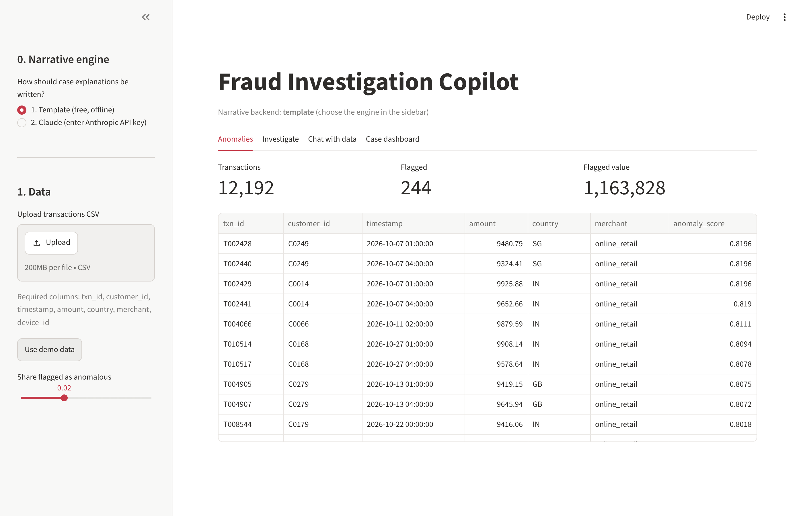
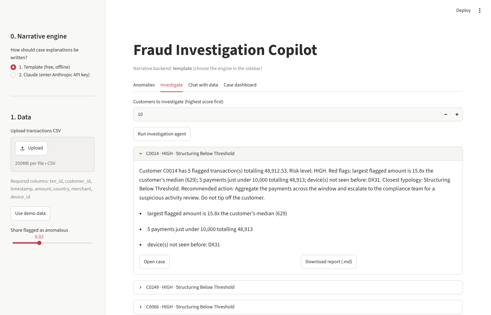
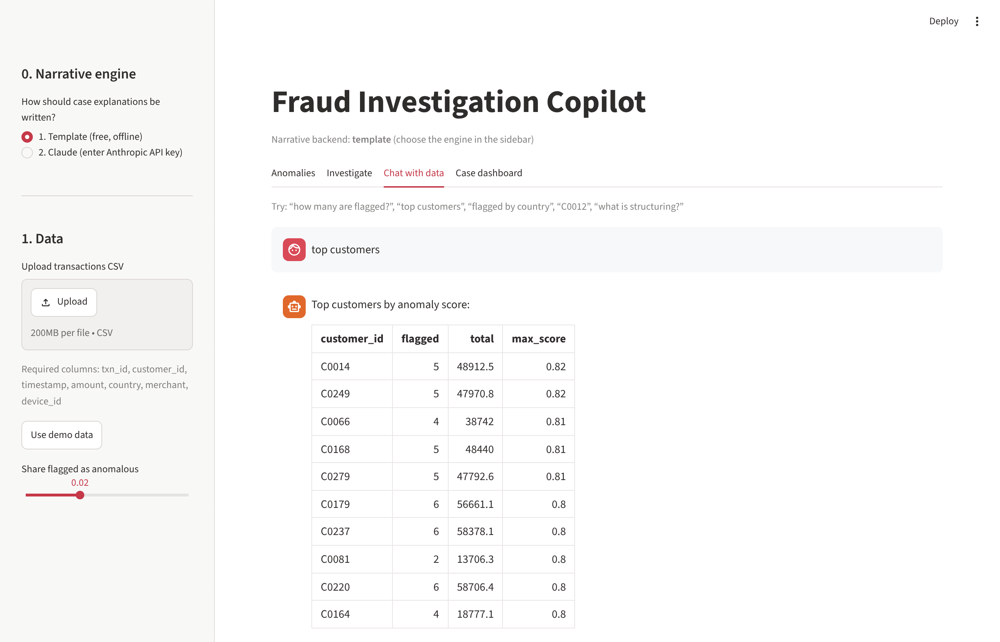

# Fraud Investigation Copilot

An AI-assisted fraud investigation tool. Upload a transaction CSV, flag anomalies with ML, let an investigation agent explain each suspicious customer with evidence, chat with the data, and track cases to closure.

> **Personal portfolio project on synthetic data.** It has no production users, and the accuracy numbers below come from data I generated myself. See [Limitations](#limitations).

| Anomalies | Investigate | Chat |
|---|---|---|
|  |  |  |

## Features

- **Upload and detect:** CSV upload, per-customer features, and an unsupervised IsolationForest that scores every transaction.
- **Investigation agent:** for each flagged customer it runs fixed tools (profile, velocity, geography, structuring, devices), turns the numbers into red flags, retrieves the matching fraud typology from a small knowledge base, and writes an explanation from that evidence only.
- **Reports:** downloadable markdown case report with the transactions reviewed, evidence, recommended action, sources and limitations.
- **Chat with the dataset:** questions are routed to fixed pandas queries (no generated code is executed), with a knowledge-base fallback.
- **Case dashboard:** SQLite-backed cases with a status workflow (Open, Under review, Escalated, Closed) and notes.
- **Two narrative engines, your choice:** pick **1. Template** (free, offline) or **2. Claude** and paste your Anthropic API key in the sidebar.

## Quick start

```bash
git clone https://github.com/<your-username>/fraud-investigation-copilot.git
cd fraud-investigation-copilot
python -m venv .venv && source .venv/bin/activate   # Windows: .venv\Scripts\activate
pip install -r requirements.txt
streamlit run app.py
```

Then click **Use demo data**, or upload `data/transactions.csv` (a 12,192-row synthetic sample), then open the **Investigate** tab.

Required CSV columns: `txn_id, customer_id, timestamp, amount, country, merchant, device_id`. Extra columns are ignored.

### Using Claude for the explanations

In the sidebar, choose **2. Claude (enter Anthropic API key)** and paste your key. Use **Test key** to confirm it works. The key lives only in your browser session's memory. It is never written to disk, logged or included in reports. The model name defaults to `claude-sonnet-5-5` and can be changed with the `COPILOT_MODEL` environment variable.

If you set `ANTHROPIC_API_KEY` in your environment, scripts and tests use it, but the sidebar choice always wins in the app. If Claude is unavailable, the app falls back to the template and says so.

**Privacy:** in Claude mode, a case's evidence summary (customer ID, transaction IDs, amounts, flags) is sent to the Anthropic API. Do not use real customer data unless your organisation permits it. In Template mode nothing leaves your machine.

## How it works

```
CSV -> features -> IsolationForest -> flagged customers
                                          |
              +---------------------------+
              v
   Investigator agent: tools -> red flags -> retrieve typology -> explanation (template or Claude)
              |
              +--> case report (.md)      +--> SQLite case tracker
```

| Module | What it does |
|---|---|
| `copilot/detector.py` | Features: amount vs. the customer's median, transactions in the last hour, foreign country, night-time, amounts just under 10,000. IsolationForest scoring. Fraud labels are never used for training. |
| `copilot/investigator.py` | The agent: runs the tools, builds red flags and a risk level, retrieves the typology, requests the explanation. |
| `copilot/retriever.py` | Knowledge base split on markdown headings (title kept as metadata). Hybrid word and character TF-IDF with domain query expansion and a benign-chunk prior. `mode="baseline"` keeps the original retriever for comparison. |
| `copilot/llm.py` | Template or Claude narrative with a safe fallback. The LLM only explains evidence computed in Python. |
| `copilot/chat.py` | Safe, fixed-query chat over the data. |
| `copilot/cases.py`, `report.py` | SQLite case tracker and markdown reports. |
| `knowledge/typologies.md` | Fraud typologies: velocity attack, amount spike, unusual geography, structuring, report standards, false-positive guidance. |
| `eval.py`, `eval_sets.py` | Repeatable evaluation and the labelled query sets. |

## Evaluation

Run `python eval.py` to reproduce everything below (results are saved to `eval_results.json`).

**Detection** (synthetic data, injected fraud labels used only for scoring):

| Metric | Result |
|---|---|
| Fraud customers flagged | 40 / 40 (customer recall 1.00) |
| Customer precision | 0.43 (93 customers flagged) |
| Transaction precision / recall | 0.65 / 0.88 |
| Agent typology accuracy | 40 / 40 (optimistic, see below) |

**Retrieval.** The first evaluation showed a benign-cause chunk ("large legitimate purchase") outranking suspicious-pattern chunks, because they share words and TF-IDF matches words, not meaning. The fix was hybrid scoring, query expansion and a down-weight on the benign chunk unless the query has benign cues.

| Query set | Baseline recall@1 | Improved recall@1 | Note |
|---|---|---|---|
| Dev (10) | 0.80 | 1.00 | where the failure was found, so biased |
| Held-out (20) | 0.80 | 1.00 | I saw its misses before the fix, so biased |
| **Fresh (20)** | **0.70** | **0.85** | written after the fix and run once. The only unbiased number |

Three fresh queries still miss. I left them alone on purpose rather than tuning to the test.

## Limitations

- **Synthetic data.** The fraud patterns come from `copilot/data_gen.py`, and the agent's rules assume the same patterns. The 40/40 typology accuracy shows the pipeline is wired correctly, not that it works on real fraud. Real data would score lower.
- **Low precision.** 0.43 customer precision means more than half of the flagged customers are false alerts. A real deployment would set the threshold from the review team's capacity.
- **Small, author-written query sets.** Only the fresh set is an unbiased estimate, and 20 queries is a small sample.
- **Lexical retrieval.** TF-IDF plus rules, not semantic. A dense embedding model with a reranker is the next step, and I have not benchmarked one yet.
- **Not production-ready.** No authentication, access control or audit logging. A human must make every decision about an account.

## Roadmap

- Dense embeddings plus a reranker, evaluated on a larger independent query set.
- Train and calibrate the detector on labelled historical cases.
- Check that each explanation's claims appear in the evidence.
- Role-based access, masking of personal data and an audit log.

## Development

```bash
pytest -q tests          # 10 tests
python eval.py           # reproduce the metrics
python copilot/data_gen.py   # regenerate data/transactions.csv
```

Tested with Python 3.13, Streamlit 1.67, pandas 3.0 and scikit-learn 1.9.

## License

MIT. See [LICENSE](LICENSE).
